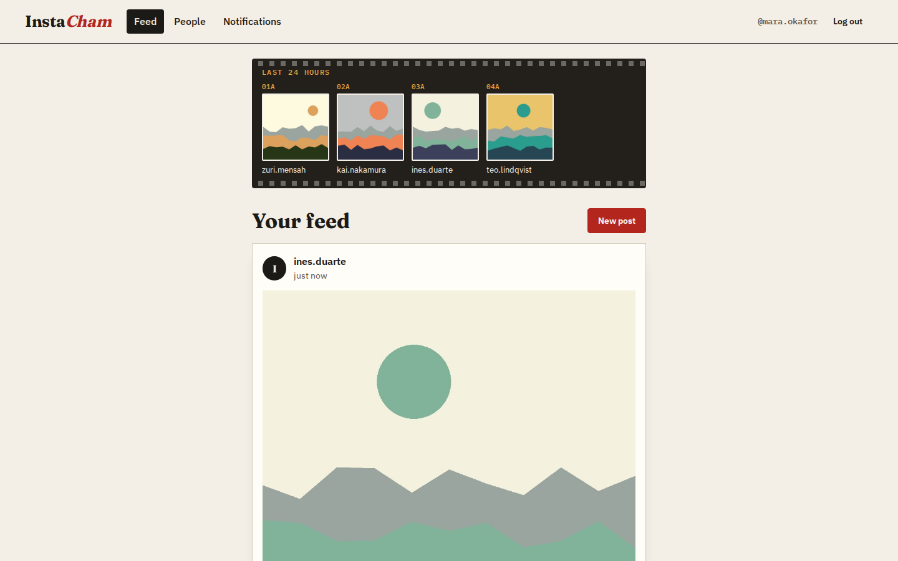
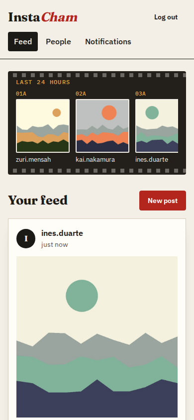
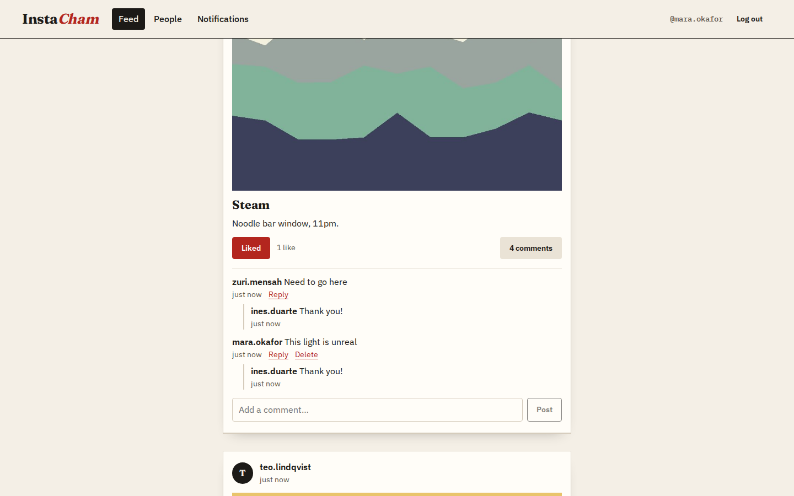
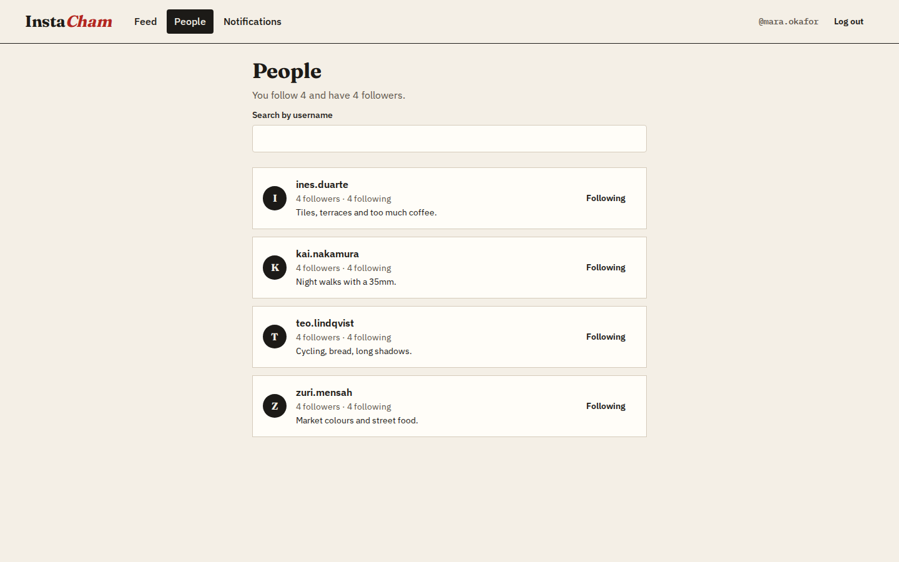
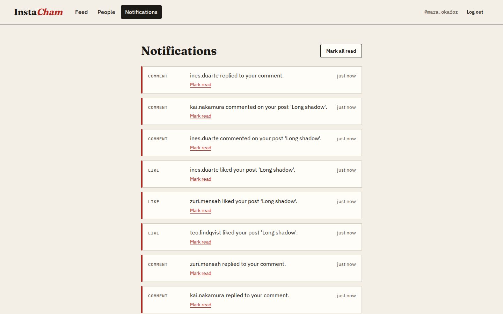
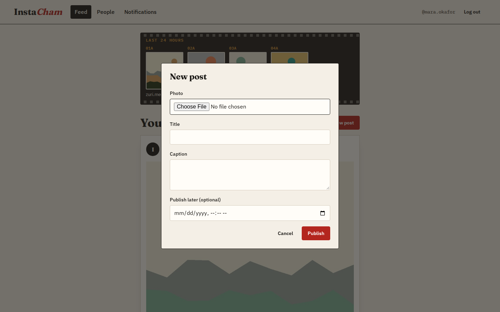
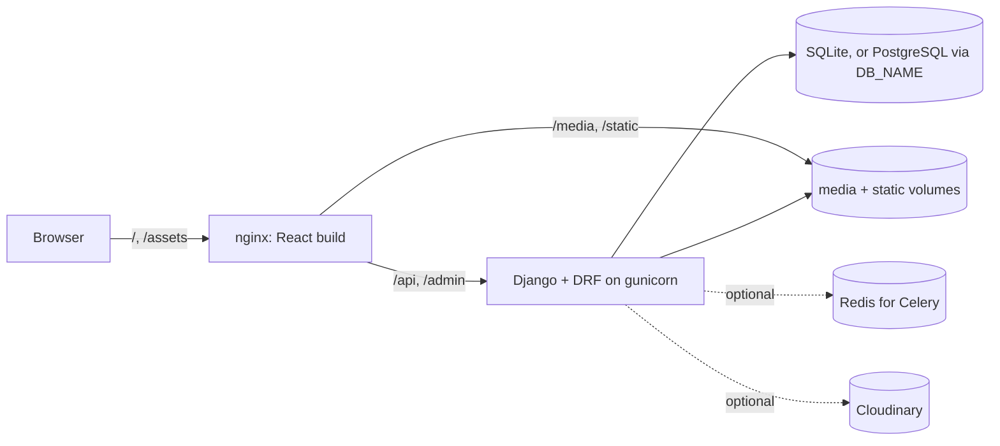

# InstaCham

A small Instagram-style photo sharing app: a Django REST API in `check_back/` and a
React client in `frontend/`. People sign up with an email address, follow each other,
post photos (now or at a scheduled time), like and comment with one level of replies,
see a 24-hour story strip from the people they follow, and get notified about follows,
likes and comments.

It started as a take-home exercise. The UI is styled as a darkroom contact sheet:
posts are prints on paper, stories run along a strip of film.



| Phone | Comments and replies |
| --- | --- |
|  |  |

| People to follow | Notifications | New post |
| --- | --- | --- |
|  |  |  |

All screenshots use the fictional accounts and generated pictures from `seed_demo`.

## What the brief asked for

The exercise described a simplified Instagram with:

- email/password sign-up and login with JWT or sessions and hashed passwords;
- everything behind login, with people only able to change or delete their own posts,
  comments and stories, and clear errors otherwise;
- image posts with a caption and timestamp, newest first;
- follow/unfollow with follower counts, and a feed limited to people you follow;
- likes with a visible count and a list of who liked a post;
- comments with replies one level deep;
- stories (image or short video) that disappear after 24 hours, shown in a story bar;
- posts scheduled for a future time that only appear once that time has passed;
- notifications for new followers, likes and comments, with mark-as-read;
- a minimal, responsive React UI covering login, posting, following, liking,
  commenting and viewing stories.

What is implemented and what is not is listed under [Status](#status).

## Architecture



- `apps/users`: custom email-login user, profile, follows, `me`, follow/unfollow and the
  `seed_demo` command.
- `apps/posts`: posts, likes, comments. `queries.py` builds the feed in two queries:
  counts and "liked by me" are annotations, authors are joined, replies are prefetched.
- `apps/stories`: stories with a 24-hour expiry and a Celery task that deletes expired
  ones together with their files.
- `apps/notifications`: notifications written by signals, mark one or all as read, and
  optional Web Push.
- `core/`: settings (everything from environment variables), the shared
  `IsOwnerOrReadOnly` permission, upload validators and pagination.

## Run it with Docker Compose

Needs Docker with Compose v2.

```sh
cp .env.example .env
# put a long random value in DJANGO_SECRET_KEY, e.g.
python3 -c "import secrets; print(secrets.token_urlsafe(50))"

docker compose up --build -d
docker compose exec backend python manage.py seed_demo --password 'choose-a-demo-password-1!'
```

Open http://localhost:8080 and log in as `mara@demo.instacham.test` with the password
you chose. API docs are at http://localhost:8080/api/docs/.
`docker compose down -v` stops everything and deletes the data volumes.

Both containers run as non-root users (`app`, uid 10001, and `nginx`). Without a
broker, Celery tasks run inline, so notifications work but the periodic story purge
does not run; expired stories are still hidden by the API.

## Local development

Python 3.12 and Node 22 (`.python-version`, `.nvmrc`).

```sh
# API on http://localhost:8000
cd check_back
python3.12 -m venv .venv && . .venv/bin/activate
pip install -r requirements-dev.txt
cp .env.example .env            # sets DJANGO_DEBUG=1 and uses SQLite
python manage.py migrate
python manage.py seed_demo --password 'choose-a-demo-password-1!'
python manage.py runserver

# UI on http://localhost:5173 (proxies /api and /media to :8000)
cd frontend
npm ci
npm run dev
```

With `DJANGO_DEBUG` off, the settings refuse to start without `DJANGO_SECRET_KEY`.
Set `DB_NAME`, `DB_USER`, `DB_PASSWORD` and `DB_HOST` to use PostgreSQL, `CLOUDINARY_URL`
to store uploads on Cloudinary, `CELERY_BROKER_URL` for a real Celery broker and
`VAPID_PRIVATE_KEY` to send Web Push messages. `check_back/.env.example` lists them all.

## Tests

```sh
cd check_back && pytest                       # 48 tests (pytest-django)
cd frontend && npm run lint && npm test       # ESLint + 22 tests (Vitest, Testing Library)
```

The backend suite covers ownership rules on posts, comments, stories, accounts and
notifications; upload type and size limits; pagination; query counts for the feed and
comment threads; feed visibility, scheduling, follows and story expiry. The frontend
suite covers paging with "Load more", owner-only delete buttons, client-side photo
checks, optimistic likes with rollback, and empty and error states.

## API at a glance

All endpoints except registration, login and the docs need `Authorization: Bearer <access>`.
Lists are paginated with `?page=` and `?page_size=` (at most 50).

| Method and path | Purpose |
| --- | --- |
| `POST /api/users/users/` | register (`email`, `username`, `password`) |
| `POST /api/token/`, `POST /api/token/refresh/` | obtain and refresh JWTs |
| `GET /api/users/users/me/` | the logged-in account with counts |
| `GET /api/users/users/?search=` | find people (no emails exposed) |
| `POST /api/users/users/{id}/follow/`, `.../unfollow/` | follow or unfollow |
| `GET, POST /api/posts/posts/` | feed of you and people you follow; create (multipart) |
| `PATCH, DELETE /api/posts/posts/{id}/` | owner only |
| `POST /api/posts/posts/{id}/like/`, `.../unlike/` | like or unlike |
| `GET /api/posts/posts/{id}/likes/`, `.../comments/` | who liked it; comments with replies |
| `POST /api/posts/comments/` | comment or reply (`post`, `text`, `parent`) |
| `GET /api/posts/user-posts/` | your own posts, including scheduled ones |
| `GET, POST /api/stories/` | live stories from you and people you follow |
| `GET /api/notifications/?unread=1` | your notifications |
| `POST /api/notifications/mark-all-read/` | mark everything read |

Responses captured from the Compose stack with the demo data:

```http
GET /api/posts/posts/?page_size=1
Authorization: Bearer eyJhbG...

200 OK
{
  "count": 8,
  "next": "http://localhost:8080/api/posts/posts/?page=2&page_size=1",
  "previous": null,
  "results": [
    {
      "id": 8,
      "title": "Steam",
      "user": 3,
      "author": { "id": 3, "username": "ines.duarte", "avatar": null },
      "caption": "Noodle bar window, 11pm.",
      "image": "http://localhost:8080/media/posts/demo-7.jpg",
      "scheduled_for": null,
      "created_at": "2026-11-10T15:34:55.286683Z",
      "is_published": true,
      "likes_count": 1,
      "comments_count": 4,
      "is_liked": true
    }
  ]
}
```

```http
PATCH /api/posts/posts/8/          (a post by someone else)
{"caption": "mine now"}

403 Forbidden
{"detail": "You can only change or delete your own content."}
```

```http
POST /api/posts/posts/             (multipart, image is not a real picture)

400 Bad Request
{"image": ["Upload a valid image. The file you uploaded was either not an image or a corrupted image."]}
```

## Design notes

- **Ownership in one place.** `core/permissions.py` holds `IsOwnerOrReadOnly`; every
  viewset that edits user content uses it, so a 403 always carries the same message.
- **Visibility is a queryset, not a check.** Posts and stories you are not allowed to
  see are simply not in the queryset, so they return 404 rather than leaking existence.
- **Counts without N+1.** The feed is two SQL queries for any page size; a test pins this.
- **Uploads are checked twice.** The UI rejects wrong types and files over 5 MB before
  uploading; the API enforces the same limits (images 5 MB, story videos 25 MB) and
  Pillow verifies that images really are images.
- **Runs without services.** SQLite, local media and inline Celery tasks are the
  defaults, so the project starts with nothing but Python; Postgres, Redis and
  Cloudinary are switched on by environment variables.

## Status

Implemented: everything in the API table above, the React pages for login, sign-up,
feed with stories, posting and scheduling, likes, comments and replies, people/follow
and notifications.

Not done yet:

- There is no UI for uploading stories or editing profiles and avatars; both work
  through the API.
- Private accounts: following one creates an unaccepted request, but there is no
  endpoint or UI to accept it.
- The 24-hour purge needs Celery beat with a broker; the Compose setup does not include
  Redis, so expired stories are hidden rather than deleted there.
- Web Push needs a VAPID key pair and a service worker in the client, which does not
  exist yet.

## License

MIT, see [LICENSE](LICENSE).
